

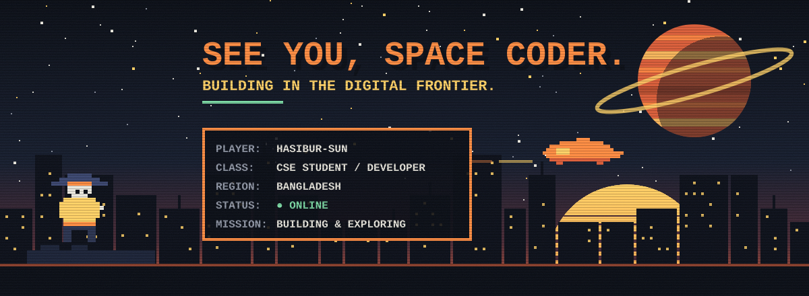

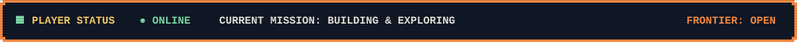

<a href="https://hasibur-sun.github.io/">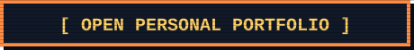</a>

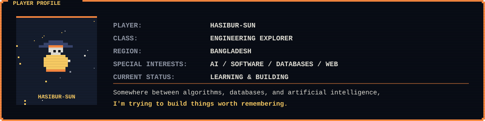

A CSE student from Bangladesh, learning by building. Mostly AI and machine learning, web, Android, databases and algorithms, with a habit of poking at whatever language or tool looks interesting next.

Still exploring. Still experimenting. Still chasing the next interesting problem. And when the screen is off: ideas, side projects, things made by hand.

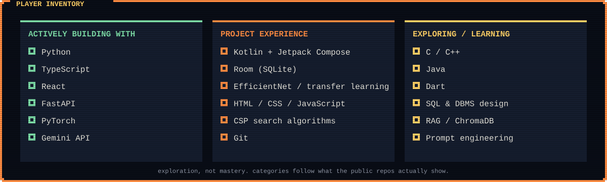

<table>
<tr>
<td width="50%"><a href="https://github.com/Hasibur-sun/crop-guardian">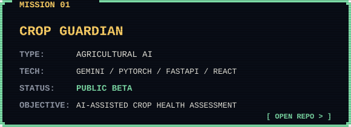</a></td>
<td width="50%"><a href="https://github.com/Hasibur-sun/garbage-classification-efficientnet">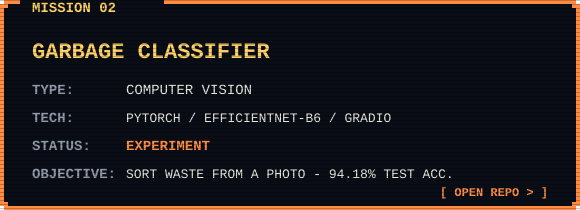</a></td>
</tr>
<tr>
<td width="50%"><a href="https://github.com/Hasibur-sun/Intelligent-Sudoku-Solver-CSP">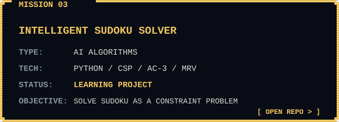</a></td>
<td width="50%"><a href="https://github.com/Hasibur-sun/minimal-android-noteapk">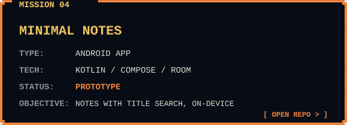</a></td>
</tr>
<tr>
<td width="50%"><a href="https://github.com/Hasibur-sun/lazy-pad">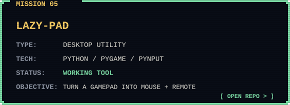</a></td>
<td width="50%" valign="middle" align="center">More signals in the <a href="https://github.com/Hasibur-sun?tab=repositories">full archive</a>.</td>
</tr>
</table>

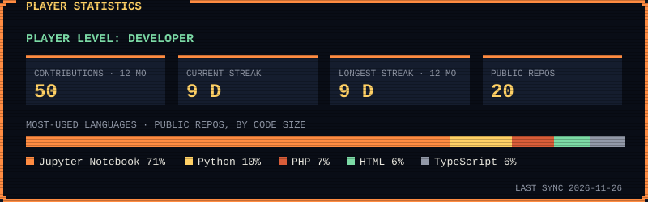

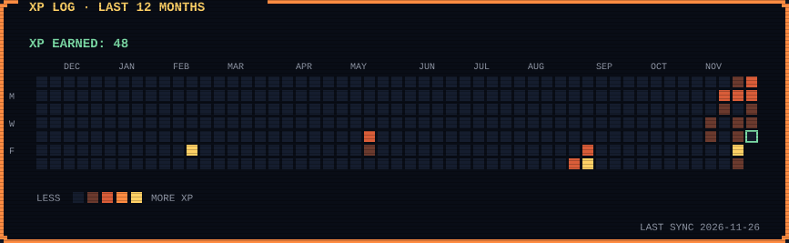

Stats and the heatmap are generated from the GitHub API by a scheduled workflow (<a href="scripts/pixel_stats.py"><code>scripts/pixel_stats.py</code></a>). Nothing is hand-typed.

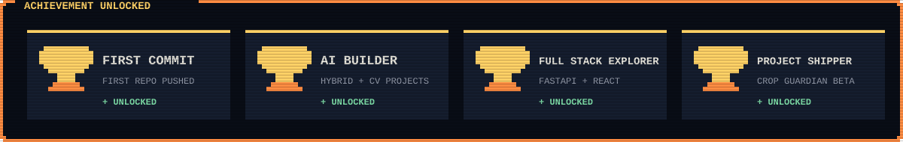

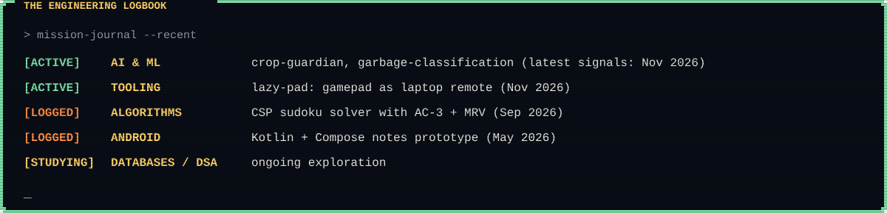

<table>
<tr>
<td width="50%">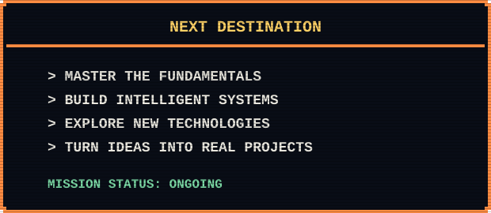</td>
<td width="50%">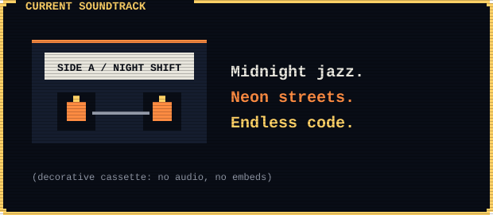</td>
</tr>
</table>

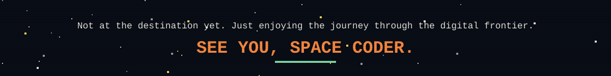

